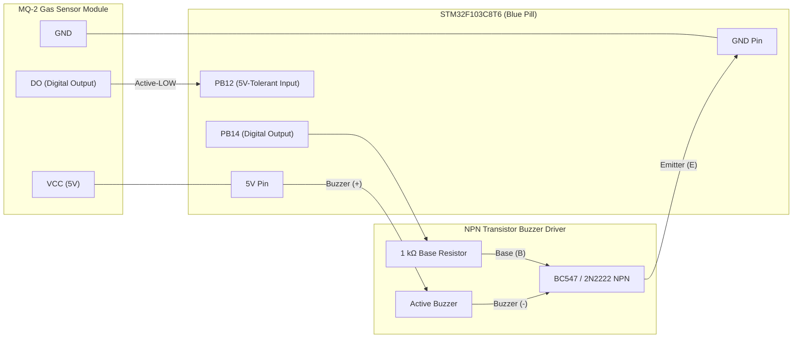

# MQ-2 Gas & Smoke Leak Detection Alarm

A gas and smoke leak detection alarm system engineered for the **STM32F103C8T6 (Blue Pill)** using the Arduino core for STM32 (STM32duino). The firmware monitors the digital comparator output (`DO`) of an **MQ-2 combustible gas/smoke sensor** on a 5V-tolerant STM32 GPIO pin (`PB12`), includes a 10-second tin-dioxide ($\text{SnO}_2$) heater stabilization warm-up window, logs live sensor telemetry over Serial (`115200` baud), and drives an acoustic buzzer through an NPN transistor switch (`PB14`).

---

## Hardware Requirements

- **Microcontroller**: STM32F103C8T6 "Blue Pill" (ARM Cortex-M3 @ 72 MHz)
- **Gas/Smoke Sensor**: MQ-2 Gas Sensor Module (detects LPG, propane, methane, hydrogen, alcohol, and smoke; features onboard LM393 comparator and sensitivity trim potentiometer)
- **Acoustic Actuator**:
  - 5V Active Buzzer
  - 1x NPN Transistor (BC547 or 2N2222)
  - 1x 1 kΩ base current-limiting resistor
- **Prototyping**: Solderless breadboard, jumper wires, and 5V USB power source

---

## Pinout and Hardware Wiring

| Peripheral / Component | Module Pin | STM32 Pin | Function / Mode | Electrical Connection Notes |
| :--- | :--- | :--- | :--- | :--- |
| **MQ-2 Gas Sensor** | `DO` (Digital Out) | `PB12` | `INPUT_PULLUP` | **5V-tolerant pin** on STM32F103. Active-LOW (`LOW` = gas detected, `HIGH` = clean air). |
| **MQ-2 Gas Sensor** | `VCC` | `5V` | Power Rail | Connect to `5V` rail (required to heat the internal $\text{SnO}_2$ sensing coil properly). |
| **MQ-2 Gas Sensor** | `GND` | `GND` | Ground | Common system ground. |
| **Buzzer Driver (NPN)** | Base (`B`) | `PB14` | `OUTPUT` | Connected via **1 kΩ resistor** to `PB14` (`HIGH` = Buzzer ON, `LOW` = Buzzer OFF). |
| **Buzzer Driver (NPN)** | Emitter (`E`) | `GND` | Ground | Tied directly to common system ground (`GND`). |
| **Buzzer Driver (NPN)** | Collector (`C`) | Buzzer `(-)` | Low-Side Switch | Connects to negative `(-)` leg of the active buzzer; Buzzer `(+)` connects to `5V` or `3.3V`. |

---

## Hardware Connection Diagram

### 1. Visual Wiring Topology



### 2. Breadboard / Schematic Pin-by-Pin Layout

```text
                       +-----------------------------------+
                       |     STM32F103C8T6 (Blue Pill)     |
                       |                                   |
  [MQ-2 Gas Sensor]    |                                   |       [Active Buzzer + NPN Driver]
  +---------------+    |                                   |
  |           VCC |--->| 5V                                |-----> (+) [Active Buzzer] (-)
  |           GND |--->| GND                               |                            |
  |  Digital (DO) |--->| PB12 (5V-Tolerant)           PB14 |-----> [1 kΩ] ---> Base (B) |
  +---------------+    |                                   |                 [BC547/2N2222]
                       +-----------------------------------+                  Emitter (E)
                                         |                                      |
                                         +--------------------------------------+---> GND
```

---

## Operational Logic

1. **Initialization & Safe Boot Default**:
   - Configures `PB12` as `INPUT_PULLUP` and `PB14` as `OUTPUT` driven `LOW` immediately so the buzzer remains silent during initialization.
   - Initializes hardware UART (`Serial.begin(115200)`) for live diagnostic monitoring.

2. **Sensor Heater Warm-Up (`10,000 ms`)**:
   - The MQ-2 sensor uses an internal heating element to bring the $\text{SnO}_2$ sensing layer to operating temperature. Upon cold power-up, sensor resistance is momentarily unstable; a 10-second stabilization delay (`delay(10000)`) prevents false initial alarms.

3. **Continuous Gas Monitoring (`loop`)**:
   - Samples `GAS_SENSOR_PIN` (`PB12`) every `300 ms`.
   - Standard LM393 comparator modules pull `DO` **`LOW` (`0`)** when gas concentration exceeds the threshold set by the onboard potentiometer:
     - **`gasState == LOW` (`GAS_DETECTED`)**: Drives `PB14` `HIGH` to saturate the NPN transistor and sound the buzzer (`[ALERT] Gas Detected! Buzzer ON`).
     - **`gasState == HIGH` (Clean Air)**: Drives `PB14` `LOW` to turn off the buzzer (`[NORMAL] Clean Air. Buzzer OFF`).
   - *Threshold Calibration Tip*: Turn the brass screw on the MQ-2 module's blue potentiometer clockwise/counter-clockwise to adjust the trigger sensitivity threshold. If using an inverted sensor module that outputs `HIGH` on gas detection, simply change `#define GAS_DETECTED LOW` to `HIGH`.

---

## Build and Upload Instructions

1. Open [`MQ2_Gas_Alarm.ino`](MQ2_Gas_Alarm.ino) in the Arduino IDE (v2.x).
2. Ensure the **STM32 MCU based boards** package is installed via Boards Manager (**No external libraries are required**).
3. Configure board settings:
   - **Board**: `Generic STM32F1 series`
   - **Board part number**: `BluePill F103C8` (or `STM32F103C8Tx`)
   - **Upload method**: `OpenOCD STLink (SWD)` or `STM32CubeProgrammer (SWD)`
4. Connect the ST-Link V2 programmer (`SWDIO`, `SWCLK`, `GND`, `3.3V`) to the Blue Pill and click **Upload**.
