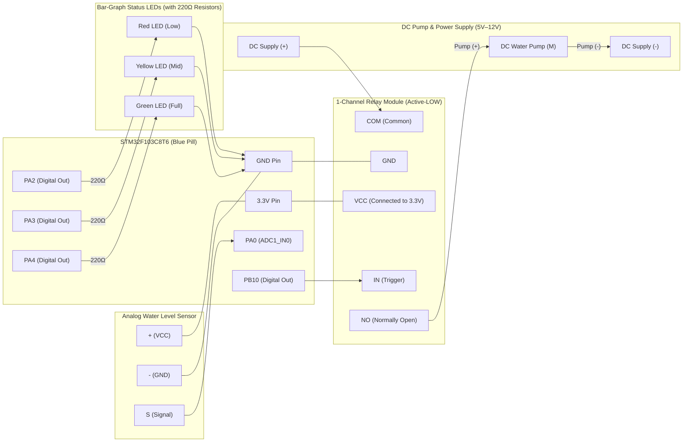
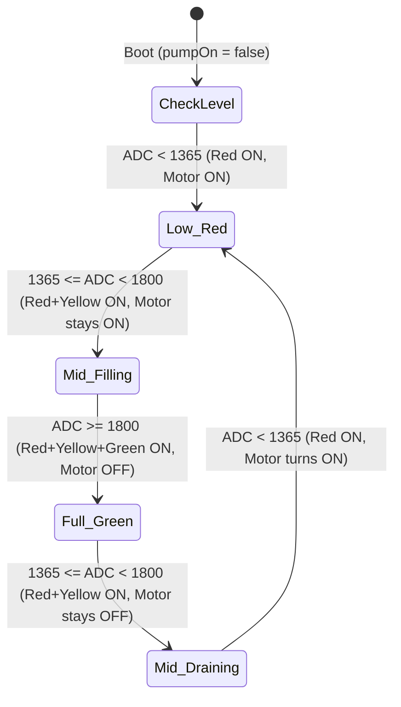

# Automatic Water Tank Level Controller

An automated water tank level monitoring and pump control system engineered for the **STM32F103C8T6 (Blue Pill)** using the Arduino core for STM32 (STM32duino). The controller samples an analog resistive water sensor through an 8-sample noise-filtering routine, visualizes water depth using a cumulative **3-LED Bar-Graph** (**Red** at Low, **Red + Yellow** at Mid, **Red + Yellow + Green** at Full), and drives an active-low relay to switch a DC water pump using **directional hysteresis logic** (turning ON only at Red and shutting OFF once Green is reached).

---

## Hardware Requirements

- **Microcontroller**: STM32F103C8T6 "Blue Pill" (ARM Cortex-M3 @ 72 MHz, 12-bit ADC)
- **Water Level Sensor**: Analog Resistive Water Level Sensor Module (e.g., HW-038 / Funduino analog water depth sensor)
- **Relay Module**: 1-Channel Active-LOW Relay Module (Songle `SRD-05VDC-SL-C` or opto-isolated relay module)
- **Water Pump**: 5V–12V DC Submersible Water Pump (switched through Relay `COM` and `NO` contacts)
- **Visual Indicators (Bar-Graph Display)**:
  - 1x Red LED (Low water level indicator)
  - 1x Yellow LED (Mid water level indicator)
  - 1x Green LED (Full water level indicator)
  - 3x 220 Ω – 330 Ω current-limiting resistors
- **Prototyping**: Solderless breadboard, jumper wires, and 5V USB power source (or external DC supply for the pump)

---

## Pinout and Hardware Wiring

| Peripheral / Component | Module Pin | STM32 Pin | Function / Mode | Electrical Connection Notes |
| :--- | :--- | :--- | :--- | :--- |
| **Water Level Sensor** | `S` (Signal) | `PA0` | `INPUT_ANALOG` (`ADC1_IN0`) | 12-bit analog input (`0–4095`). |
| **Water Level Sensor** | `+` (`VCC`) | `3.3V` | Power Rail | **Power from `3.3V`** so the analog signal stays strictly within the STM32's `0–3.3V` ADC range. |
| **Water Level Sensor** | `-` (`GND`) | `GND` | Ground | Common system ground. |
| **Relay Module** | `IN` | `PB10` | `OUTPUT` | Active-LOW control: `LOW` (`0V`) turns Relay **ON**; `HIGH` (`3.3V`) turns Relay **OFF**. |
| **Relay Module** | `VCC` | `3.3V` | Power Rail | **Connect to `3.3V`** to match STM32 logic level and guarantee clean turn-off without an external transistor. |
| **Relay Module** | `GND` | `GND` | Ground | Common ground shared with Blue Pill. |
| **DC Water Pump** | `+` / `-` | Relay `COM` & `NO` | Switched Load | Pump `+` wired through Relay **`COM` -> `NO` (Normally Open)**; Pump `-` to power supply `GND`. |
| **Red LED (Low)** | Anode (+) | `PA2` | `OUTPUT` | Connect via 220 Ω series resistor to `PA2`; cathode to `GND`. |
| **Yellow LED (Mid)** | Anode (+) | `PA3` | `OUTPUT` | Connect via 220 Ω series resistor to `PA3`; cathode to `GND`. |
| **Green LED (Full)** | Anode (+) | `PA4` | `OUTPUT` | Connect via 220 Ω series resistor to `PA4`; cathode to `GND`. |

---

## Hardware Connection Diagram

### 1. Visual Wiring Topology



### 2. Breadboard / Schematic Pin-by-Pin Layout

```text
                       +-----------------------------------+
                       |     STM32F103C8T6 (Blue Pill)     |
                       |                                   |
  [Water Sensor]       |                                   |       [Bar-Graph LEDs]
  +------------+       |                                   |
  |    VCC (+) |------>| 3.3V                         PA2  |-----> [220Ω] ---> (Red LED +)    ---|
  |    GND (-) |------>| GND                          PA3  |-----> [220Ω] ---> (Yellow LED +) ---|--> GND
  | Signal (S) |------>| PA0 (ADC1)                   PA4  |-----> [220Ω] ---> (Green LED +)  ---|
  +------------+       |                                   |
                       |                              PB10 |-----------------+
                       +-----------------------------------+                 |
                                 |               |                           |
                                 | 3.3V          | GND                       | (Direct Wire)
                                 v               v                           v
                       +-------------------------------------------------------+
                       |              VCC             GND            IN        |
                       |                                                       |
                       |            1-Channel Active-LOW Relay Module          |
                       |                                                       |
                       |              NC              COM            NO        |
                       +-------------------------------+-------------+---------+
                                                       |             |
                              (Leave NC unconnected)   |             |
                                                       |             +-----> (+) [DC Water Pump] (-)
                                                       |                                          |
                                                       +-------------------> (+) [5V-12V Supply] (-)
```

---

## Operational Logic & Bar-Graph Hysteresis

### 1. 8× Oversampling Noise Filter (`readLevel`)
Resistive water sensors experience surface ripple and electrical brush noise from DC water pumps. Every `100 ms` loop cycle, `readLevel()` captures **8 consecutive 12-bit ADC samples** spaced `2 ms` apart (`16 ms` window) and computes their arithmetic average (`0–4095`).

### 2. Directional Hysteresis & Bar-Graph LED Truth Table
To prevent relay chatter and rapid motor cycling, the controller uses a dual-threshold hysteresis zone (`LOW_THRESHOLD = 1365`, `FULL_THRESHOLD = 1800`) paired with a bar-graph LED display:

| Direction & Tank State | 12-Bit ADC (`PA0`) | Red LED (`PA2`) | Yellow LED (`PA3`) | Green LED (`PA4`) | Motor / Relay (`PB10`) | Behavior Description |
| :--- | :--- | :---: | :---: | :---: | :--- | :--- |
| **Low (Empty)** | `< 1365` | **ON** | OFF | OFF | **ON** (`PB10 = LOW`) | Tank is low — motor starts filling. |
| **Increasing (Red $\rightarrow$ Yellow)** | `1365 – 1799` | **ON** | **ON** | OFF | **ON** (Retained) | Water is rising through mid-level — motor stays **ON** until Green. |
| **Full (Reached Green)** | `>= 1800` | **ON** | **ON** | **ON** | **OFF** (`PB10 = HIGH`) | Tank is completely full — motor turns **OFF** immediately. |
| **Decreasing (Green $\rightarrow$ Yellow)** | `1365 – 1799` | **ON** | **ON** | OFF | **OFF** (Retained) | Water is draining through mid-level — motor stays **OFF**. |
| **Decreased Back to Red** | `< 1365` | **ON** | OFF | OFF | **ON** (`PB10 = LOW`) | Tank has emptied down to Red — motor turns **ON** again. |
| **Power-On in Yellow Zone** | `1365 – 1799` | **ON** | **ON** | OFF | **OFF** (`pumpOn = false`) | Safe boot default — waits until water drops to Red before starting. |



---

## Hardware Engineering Notes: Driving the Active-Low Relay from `3.3V`

### Why Relay `VCC` Is Connected to `3.3V` Instead of `5V`
1. **Preventing 5V PNP Lock-On**:
   - Standard 1-channel active-low relay modules use a PNP transistor (`S8550`/`2TY`) whose emitter is tied to `VCC`. The transistor conducts whenever $V_{\text{IN}} < V_{\text{VCC}} - 0.65\text{V}$.
   - Because the STM32 Blue Pill runs at `3.3V` (and internal protection diodes clamp GPIO pins near `~3.3V–3.6V`), powering Relay `VCC` from `5V` leaves $5.0\text{V} - 3.3\text{V} = 1.7\text{V}$ across the PNP emitter-base junction when `PB10` is `HIGH`, keeping the relay's Green input LED and motor permanently ON.
   - Connecting Relay `VCC` to **`3.3V`** makes $V_{\text{VCC}} - V_{\text{PB10(HIGH)}} = 3.3\text{V} - 3.3\text{V} = 0.0\text{V}$, guaranteeing the relay turns **100% OFF** when the tank reaches Green.
2. **Electrical Safety & Current Draw**:
   - **GPIO Pin Current (`PB10`)**: Through the relay's `1 kΩ` input resistor, `PB10` sinks only $(3.3\text{V} - 0.7\text{V}) / 1\text{k}\Omega \approx \mathbf{2.6\text{ mA}}$ when ON (well below the 20 mA pin limit).
   - **3.3V Regulator Load**: A $70\,\Omega$ relay coil at `3.3V` draws $3.3\text{V} / 70\,\Omega \approx \mathbf{47\text{ mA}}$ (running cooler than 71 mA at 5V), keeping total board consumption (~85 mA) comfortably within the Blue Pill's `3.3V` regulator rating.
   - **Flyback Protection**: The relay module's onboard freewheeling diode suppresses coil turn-off voltage spikes. Always power the **DC Water Pump motor** itself from the **`5V` pin** or an external 5V–12V supply via the relay's `COM`/`NO` screw terminals.

---

## Standalone USB Operation (Without ST-Link)

Once the firmware is flashed to the STM32 Blue Pill, the ST-Link programmer is no longer needed:
1. Unplug the 4 ST-Link wires (`SWDIO`, `SWCLK`, `3.3V`, `GND`) from the Blue Pill.
2. Ensure the **`BOOT0` jumper** is set to **`0`** so the program boots automatically from Flash memory.
3. Plug any **5V USB cable** (phone charger, power bank, or laptop USB port) into the Blue Pill's onboard USB connector:
   - The onboard regulator automatically powers the **`3.3V` pin** (for the Water Sensor and Relay `VCC`).
   - The **`5V` pin** outputs 5V directly from the USB supply (which can feed Relay `COM` for a 5V submersible pump).

---

## Build and Upload Instructions

1. Open [`Water_Tank_Controller.ino`](Water_Tank_Controller.ino) in the Arduino IDE (v2.x).
2. Ensure the **STM32 MCU based boards** package is installed via Boards Manager.
3. Configure the board settings:
   - **Board**: `Generic STM32F1 series`
   - **Board part number**: `BluePill F103C8` (or `STM32F103C8Tx`)
   - **Upload method**: `STLink` (recommended) or `STM32CubeProgrammer (Serial)`
4. Connect the ST-Link V2 programmer (`SWDIO`, `SWCLK`, `GND`, `3.3V`) to the Blue Pill and click **Upload**.
